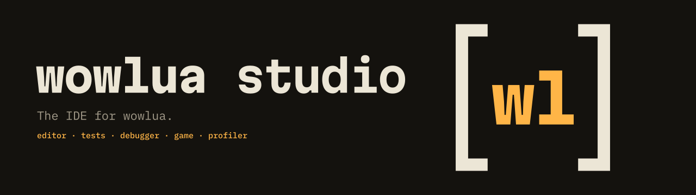

<p align="center">
  <picture>
    <source media="(prefers-color-scheme: dark)" srcset=".github/assets/wowlua-studio-banner-dark.svg">
    <source media="(prefers-color-scheme: light)" srcset=".github/assets/wowlua-studio-banner-light.svg">
    
  </picture>
</p>

<p align="center">
  <a href="https://github.com/DomenikIrrgang/wowlua-studio/actions/workflows/ci.yml"></a>
  <a href="https://github.com/DomenikIrrgang/wowlua/releases/tag/v0.13.0"></a>
  
  <a href="LICENSE"></a>
</p>

<p align="center">
  <a href="https://wowlua.dev"><b>wowlua.dev</b></a> ·
  <a href="https://github.com/DomenikIrrgang/wowlua">wowlua</a> ·
  <a href="#building">building</a> ·
  <a href="spec/roadmap.md">roadmap</a> ·
  <a href="spec/appendix/decisions.md">decisions</a> ·
  <a href="https://discord.gg/Dn795czPYk">discord</a>
</p>

---

**wowlua studio** is the IDE for [wowlua](https://github.com/DomenikIrrgang/wowlua):
edit, check, test, run, debug and profile World of Warcraft AddOns in
wowlua's emulated client, with the game's screen beside your code.

Studio is a native application for Windows, macOS and Linux, written in
Rust and drawn on the GPU. wowlua's compiler, language server, test runner,
debugger and renderer run inside it.

> [!NOTE]
> Studio is at its beginning: milestone M1 of the [roadmap](spec/roadmap.md).
> It has its window, pages and panels; opening folders comes next.

## Building

Studio needs Rust 1.96 or newer.

```console
$ cargo run --release
```

wowlua comes from its repository at the release tag set in `Cargo.toml`.

## License

[MIT](LICENSE)
